# fitnesse-compare

[](https://central.sonatype.com/artifact/io.github.tortaje/fitnesse-compare)
[](https://www.apache.org/licenses/LICENSE-2.0)

A dependency-free JSON / XML / JSON Lines / text / CSV comparison engine with FitNesse
Slim fixtures. It asserts that an actual payload matches an
**expected file** (or expected inline content) and, when it does not, says **where** and **what** differs, in one cell.

- expected content may hold **wildcards** (`${any}`, `${any-number}`, `${regex:…}`, …) so dynamic values (ids,
  timestamps) never make a test flaky;
- five Slim fixtures, `JsonComparison`, `XmlComparison`, `JsonLinesComparison`, `TextComparison` and `CsvComparison`,
  for contents no other fixture holds; the last three compare **records** (lines, rows), ordered or not;
- a public engine API (`io.github.tortaje.compare.engine`) that content-owning fixtures (REST, Kafka, MQ, S3) call in
  about five lines: see [docs/fixture-compare-integration.md](docs/fixture-compare-integration.md).

No runtime dependency: JSON and CSV are parsed by in-house parsers, XML by the JDK parser (hardened against DTD / XXE).

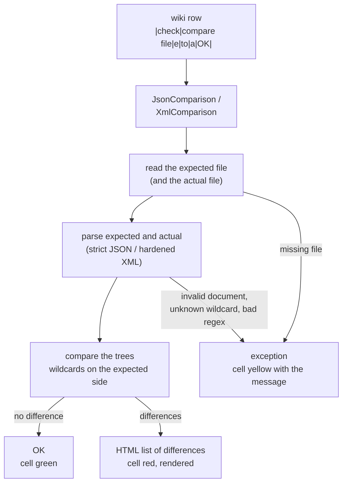

## Install

```xml
<dependency>
  <groupId>io.github.tortaje</groupId>
  <artifactId>fitnesse-compare</artifactId>
  <version>1.0.0</version>
</dependency>
```

On a FitNesse page, put the jar on the class path. No other jar is needed:

```
!path /path/to/fitnesse-compare-1.0.0.jar
```

## The fixtures

All fixtures share the same vocabulary; the class fixes the format (there is no detection).

```
|import|
|io.github.tortaje.compare|

|script|json comparison|
|check|compare file|expected/order.json|to file|out/order.json|OK|
|check|compare file|expected/order.json|to|$order|OK|
|check|compare;|!-{"id":"${any}"}-!|$order|OK|
```

Use `|script|xml comparison|` for XML, `|script|json lines comparison|`, `|script|text comparison|` or
`|script|csv comparison|` for the record formats (see [Record formats](#record-formats-json-lines-text-csv)).

| Fixture | Slim script name | Format | Expected file extensions |
|---|---|---|---|
| `JsonComparison` | `json comparison` | JSON | `.json` |
| `XmlComparison` | `xml comparison` | XML | `.xml` |
| `JsonLinesComparison` | `json lines comparison` | JSON Lines | `.jsonl`, `.ndjson` |
| `TextComparison` | `text comparison` | text, one line = one record | `.txt`, `.log` |
| `CsvComparison` | `csv comparison` | CSV | `.csv`, `.tsv` |

The extension only matters for `compareToFile` in the engine API (it picks the format) and, in `CsvComparison`, for
the `.tsv` default separator.

| Slim row | Expected | Actual |
|---|---|---|
| `compare file … to file …` | file | file |
| `compare file … to …` | file | content (cell, Slim symbol) |
| `compare; … …` | content | content |

- Every row returns `OK` or an HTML list of differences: assert it with `check … OK` (a failure shows the rendered
  differences), `check not … OK`, or `check` against the exact HTML written `!-<div>…</div>-!`. A regex check
  such as `=~/1 difference:/` works but FitNesse escapes its message, so the cell shows the HTML source.
- Files are read as UTF-8; paths are relative to the FitNesse working directory.
- `${…}` is also FitNesse's variable syntax, so inline expected content with wildcards must be written `!-…-!`.
  A `{{{ … }}}` block (its `<pre>` wrapper is removed) suits content without wildcards, such as the actual side:
  FitNesse still substitutes variables inside it, turning `${any}` into "undefined variable". Expected files have no
  such constraint. An XML document whose root element is `<pre>` is recognised (raw markup inside, or text that does
  not start with `<`) and kept as is; `<pre>&lt;x&gt;</pre>` is indistinguishable from `{}` and is unwrapped.
- A malformed document, a missing file, an unknown wildcard or an invalid regex is not a difference: the cell turns
  yellow with a `message:<<…>>` exception.

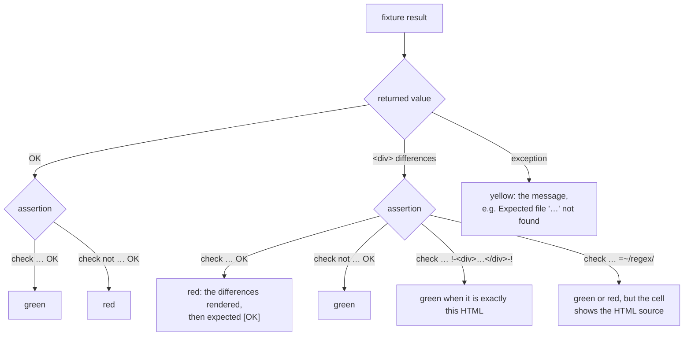

## Wildcards

Recognised only in the **expected** content, and only when the **whole** JSON string value / trimmed XML text / XML
attribute value is the marker.

| Marker | Matches |
|---|---|
| `${any}` | present, any value (JSON: including `null`, objects, arrays; XML element: any content) |
| `${any-string}` | JSON: a string. XML: any text |
| `${any-number}` | JSON: a number. XML: text parsable as a decimal number |
| `${ignore}` | any value; may be **absent** only as a JSON object value, an XML attribute, or an XML element whose content is `${ignore}` (see below). As a JSON array item it behaves as `${any}` |
| `${regex:PATTERN}` | scalar or text matching the whole value with `Pattern.matches` |

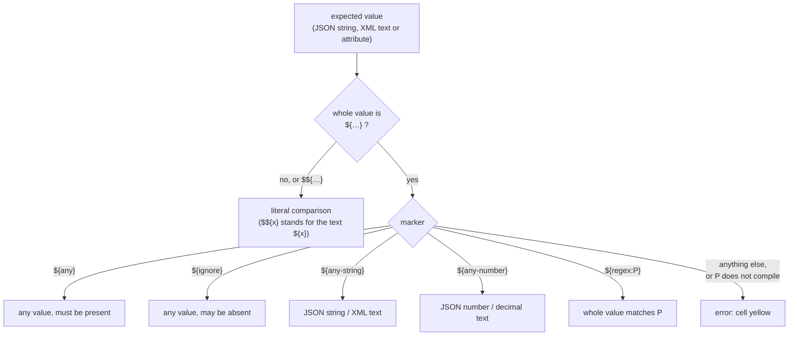

- `$${any}` is an escape: expected `"$${any}"` matches the literal actual string `${any}`.
- An unknown marker (`${anything}`) or an invalid regex is an error naming the marker and its location, so a typo never
  passes silently.

## Comparison rules

**JSON** (strict RFC 8259; duplicate keys rejected; nesting depth at most 512)

- Object keys are unordered; an expected key that is absent is `MISSING`, an extra actual key is `UNEXPECTED`.
- Arrays are compared in order, index by index; extra items are `UNEXPECTED`, missing items `MISSING`.
- Different JSON types (`"1"` vs `1`) give `TYPE`; same type with another scalar gives `VALUE`. Numbers are compared
  numerically (`1` = `1.0` = `1e0`).
- `${ignore}` as an object value lets the key be absent; as an array item it behaves as `${any}` so indexes stay
  aligned.

**XML** (JDK DOM, DOCTYPE and external entities rejected; nesting depth at most 512)

- Element and attribute names are compared by local name (`ns1:order` = `order`); `xmlns` declarations are ignored.
  Attributes of one element that share a local name (`id` and `x:id`) keep their prefix, so neither hides the other.
- Children are compared in order, position by position; attributes as a set (order ignored).
- Whitespace-only text, comments and processing instructions are ignored; text is compared after `trim`; CDATA is text.
- A `<token>${ignore}</token>` element may be absent: if the actual child at that position has another name or there
  is none, the expected element is skipped. The skip is greedy: an ignore element consumes a same-named actual element
  at that position, so expected `<t>${ignore}</t><t>x</t>` against actual `<t>x</t>` reports `/a/t[2]: missing`.
- An attribute whose expected value is `${ignore}` may be absent.

How the children of an element are walked (`e` expected, `a` actual):

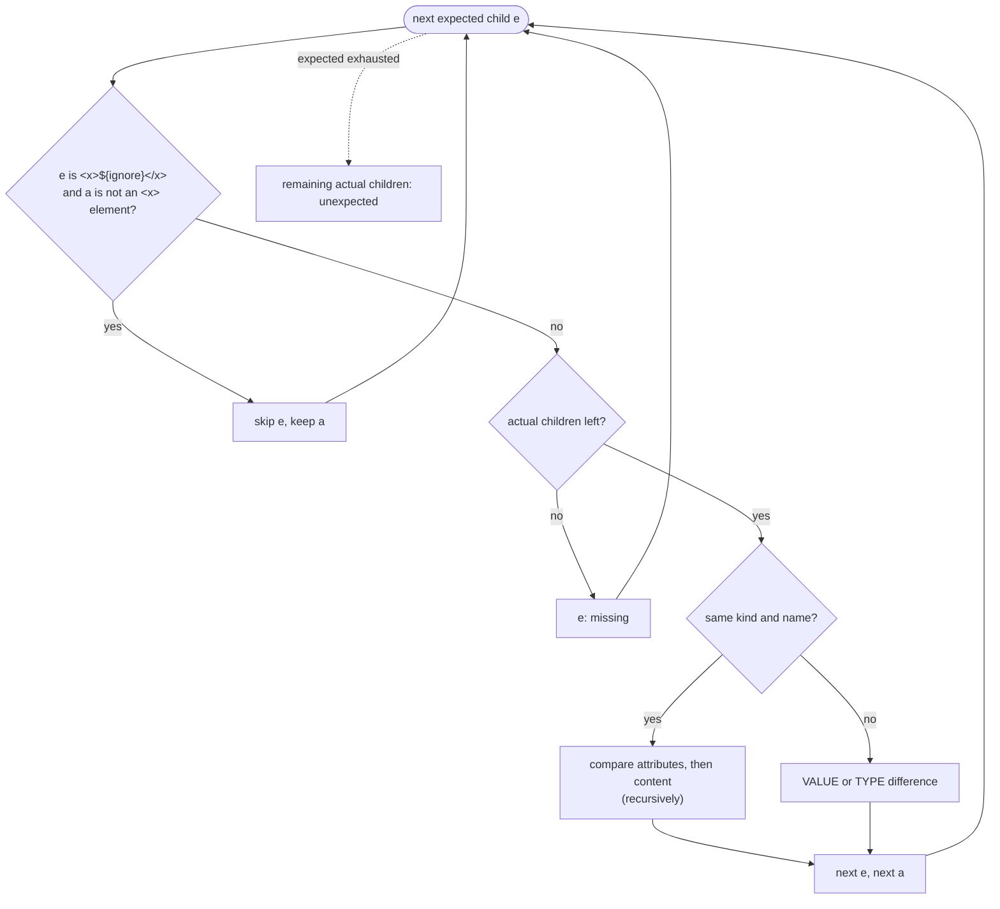

Paths are JSONPath style (`$.lines[1].qty`, `$['first name']`) or simple XPath (`/order/lines/line[2]/@qty`,
`/order/status/text()`).

## Record formats (JSON Lines, text, CSV)

JSON Lines, text and CSV compare **records**: a line or a CSV row. Wildcards, rendering and the 10-differences limit are
those of JSON and XML. Each fixture has the three usual rows plus setting rows, which hold until the end of the
`|script|` table:

```
|script|csv comparison|
|separator|;|
|key|id|
|check|compare file|expected/export.csv|to file|out/export.csv|OK|
|unordered|
|ordered|
```

| Row | Fixtures | Effect |
|---|---|---|
| `unordered` | the three | match records regardless of order |
| `key` (comma-separated names in one cell) | JSON Lines, CSV | identify records by these fields; implies `unordered` |
| `ordered` | the three | back to order-sensitive; also clears the key |
| `separator` | CSV | the field separator: one character, or `tab` (a tab cannot be typed in a wiki cell) |

A setting that does not apply to the format is an error (`Option 'key' does not apply to TEXT`), as is a `"`, CR or LF
separator. In the engine API the same settings are `CompareOptions.defaults().unordered().key("id").separator(';')`:

| `CompareOptions` | Meaning | Applies to |
|---|---|---|
| `unordered()` | match records regardless of order | JSON Lines, text, CSV |
| `key(String... names)` | identify records by CSV columns or JSON Lines simple paths (`id`, `order.id`); implies `unordered()`; several names make a composite key | JSON Lines, CSV |
| `separator(char c)` | CSV field separator (default `,`; `.tsv` files read by `compareToFile` or by `CsvComparison` default to tab) | CSV |
| `ordered()` | back to the default; also clears the key | all three |

### JSON Lines

- Each non-blank line is one JSON document; blank lines are ignored; CRLF and a leading BOM are accepted. An empty
  content is zero records, not an error.
- Records are compared by the JSON rules and wildcards above. A parse error names the physical line:
  `actual: line 12: unexpected character 'x' at column 5`.
- `key`: a simple path of member names (`id`, `order.id`). The key value is compared through its JSON text (`"7"`
  is not `7`), so `1` and `1.0` (or `007` and `7`) are different keys; a record without the key never matches by
  key. The key must be literal in the expected content (no wildcard anywhere in its value).
- Paths: `line[12]$.id`, where 12 is the physical line in the actual content.

### Text

- One line = one record. CRLF equals LF, trailing whitespace is ignored, blank lines count except at the end of the
  content, a leading BOM is dropped. An empty content is zero records.
- The expected line is a pattern: the whole actual line must match. Everything but the markers is literal (regex
  metacharacters, `$` and braces included). The markers are compiled into one regular expression for the whole
  line, so capturing groups are numbered across the line (in `${regex:(z)}-${regex:(a)\1}`, `\1` is the group of
  the first marker). Braces inside a regex marker must be balanced: a marker that never closes, such as
  `${regex:\{}`, is not a marker and the line is compared as literal text.

| Marker in an expected line | Matches |
|---|---|
| `${any}` | any characters, possibly none |
| `${any-string}` | one or more characters |
| `${any-number}` | a decimal number (`-?\d+(\.\d+)?([eE][+-]?\d+)?`) |
| `${regex:P}` | a fragment matching `P` (1 s limit, as everywhere) |
| `${ignore}` | as the whole line: any line, or no line at all (optional, see below); inside a line: same as `${any}` |
| `$${…}` | the literal text `${…}` |

- Ordered: an expected `${ignore}` line is skipped when the next expected line matches the actual line, otherwise it
  consumes that actual line; at the end of the actual content it is skipped. Unordered: `${ignore}` lines are dropped.
- Inline expected content with markers must be written `!-…-!` (FitNesse variable syntax), as for JSON.
- `key` does not apply to text. Paths: `line[12]`; a difference shows the pattern as written:
  `line[12]: expected "… INFO Order ${any} created" but was "…"`.

### CSV

- RFC 4180: quoted fields, `""` for a quote, line breaks inside quotes; fully empty lines are ignored; a leading BOM is
  dropped; CRLF and LF both end a record. A field count different from the header is an error that names the physical
  line where the record starts (`actual: line 7: 3 fields, header has 4`), as are an unterminated quote and a
  duplicate column name. A content without a header is `expected: content is empty`.
- The header is mandatory. Columns are compared **by name; their order does not matter**. If the two sets of names
  differ, the result is one difference (`header: expected [id, amount] but was [id, total]`) and rows are not compared.
- Cells: the whole cell can be a wildcard (`${any}`, `${any-string}` and `${ignore}` = any value, `${any-number}`,
  `${regex:…}`; `${any-number}` takes a decimal such as `-12.5e3`, not `+1.` or `.5`).
  Two cells that both parse as decimals (`BigDecimal`, no trim) are equal by value (`10` = `10.0`);
  anything else is exact text, so with `;` as separator `1,5` is text. A cell is never trimmed.
- `key`: one or more column names (composite key). Key values compare as text, so `1` and `1.0` (or `007` and
  `7`) are different keys. A name absent from the expected header is an error
  (`key column 'idd' not in expected header [id, amount]`).
- Paths: `row[4].amount`, `row[4]['unit price']`, where 4 is the rank of the data row in the actual content, the
  header excluded.

### Matching records

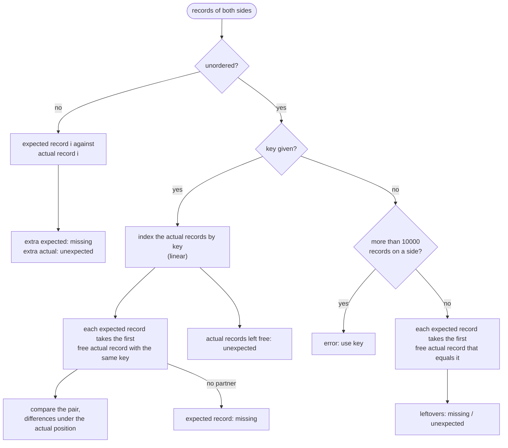

- Duplicate keys pair in order of appearance. A key must be literal in expected content (`key 'id' cannot be a wildcard
  in expected row 3`, `line 3` for JSON Lines).
- Without key, an expected record is paired only with an actual record that matches with no difference (wildcards
  included); there is no closest-match pairing.
- A matched or unexpected record shows its **actual** position; a missing record shows the **expected** one and its
  value: `expected row[2]: missing {id=7, amount=3}`, `expected line[5]: missing "…"`. In JSON and XML, `missing`
  stays bare.

## Rendering of differences

`toText()` (engine) and `toHtml()` (fixtures) list all differences found, up to 10, then `… and N more`; every
value is cut at 80 characters with `…`.

```
2 differences: $.lines[1].qty: expected 1 but was 3; $.status: missing
```

In a wiki cell the same result is rendered as `<div><b>2 differences:</b><br>$.lines[1].qty: expected <code>1</code>
but was <code>3</code><br>…</div>`, with paths and values HTML-escaped. A matching comparison renders `OK`.

For JSON Lines, text and CSV the path starts with the record (`line[N]`, `row[N]`); a missing record names the
expected position and shows the record, an extra one is `unexpected`:

```
3 differences: row[1].amount: expected 10 but was 12; expected row[2]: missing {id=2, label=Gadget, amount=20};
row[3]: unexpected {id=4, label=Doohickey, amount=1}
```

A failing `check … OK` against `src/test/resources/e2e/expected/order.json` and `order.xml` (page
`ReadmeFailureDemo`, which fails on purpose):

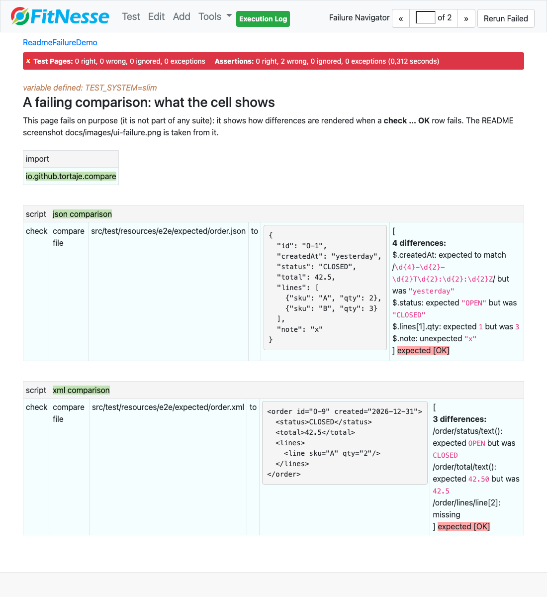

The same for `orders.jsonl` (with `|key|ref|`), `app.log` and `export.csv` (with `|separator|;|` and `|key|id|`) —
page `RecordFormatsFailureDemo`, which also fails on purpose:

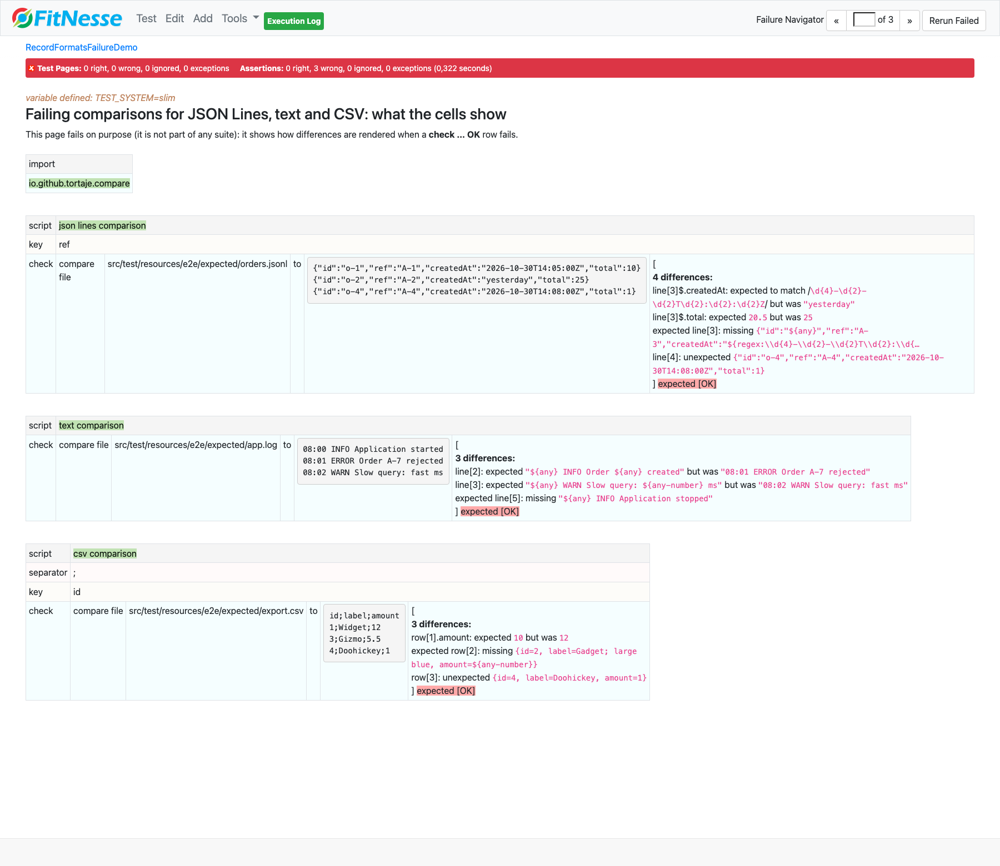

## Limits

- Documents are compared in memory, one linear pass each; there is no size limit beyond the JVM heap.
- JSON nesting is limited to 512 levels (an error, never a `StackOverflowError`).
- XML element nesting is limited to 512 levels (`<side>: nesting deeper than 512`, the same on every JDK >= 17) and to
  10000 attributes per element (the JDK 24+ default limits of 100 levels and 200 attributes do not apply).
- A `${regex:…}` whose matching exhausts the stack on a long value is reported as an error (`… is too complex for a
  value of N characters`), never a `StackOverflowError`; one that backtracks for more than 1 s (such as `(.*a){12}`)
  is an error too (`… took longer than 1000 ms …`), never a hung test.
- Unordered comparison **without key** is limited to 10,000 records on either side (an error: `unordered comparison
  without key is limited to 10000 records: use key`); with a key it stays linear (100,000 CSV rows are fine).
- An expected file with an unknown extension is an error that lists them all (`… use a .json, .xml, .jsonl, .ndjson,
  .txt, .log, .csv or .tsv file`).
- Not supported: schema validation, binary content, order-insensitive JSON arrays, partial-string wildcards in JSON
  / XML / CSV cells, CSV without a header.

## For fixture authors

Content-owning fixtures add a `compare to file` row by calling the engine; see
[docs/fixture-compare-integration.md](docs/fixture-compare-integration.md).

## Build and release

```
mvn verify                  # unit tests, FitNesse end-to-end suite, PackagedJarIT on the jar
mvn -Prelease deploy        # sources, javadoc, GPG signatures, upload to the Central Portal
```

The release profile uses `central-publishing-maven-plugin` with `autoPublish=false`: the deployment is validated and
then published manually from the Central Portal. Releases are tagged `vX.Y.Z`.

## Trying the fixtures from the FitNesse UI

`CompareSuite` holds one page per usage scenario and format; `CompareErrorSuite` holds every error case (18 rows,
all expected to raise). Both run in `mvn verify`.

| Format | Pages of `CompareSuite` |
|---|---|
| JSON | `JsonSources`, `JsonWildcards`, `JsonNormalisation`, `JsonDifferences` |
| XML | `XmlSources`, `XmlWildcards`, `XmlNormalisation`, `XmlDifferences` |
| JSON Lines | `JsonLinesSources`, `JsonLinesRules`, `JsonLinesOrdering`, `JsonLinesDifferences` |
| Text | `TextSources`, `TextPatterns`, `TextOrdering`, `TextDifferences` |
| CSV | `CsvSources`, `CsvRules`, `CsvOrdering`, `CsvDifferences` |

`…Sources` shows the three row shapes, `…Wildcards` / `…Rules` / `…Patterns` / `…Normalisation` what is equal,
`…Ordering` the `ordered`, `unordered` and `key` setting rows, `…Differences` the paths and the rendering.
`ReadmeFailureDemo` and `RecordFormatsFailureDemo`, outside the suites, fail on purpose to show failing cells.

To run them by hand:

```
scripts/fitnesse-ui.sh start    # builds, then FitNesse on http://localhost:9090 only (FITNESSE_PORT to change it;
                                # it refuses to start when the port is already taken)
scripts/fitnesse-ui.sh stop
```

Open `http://localhost:9090/CompareSuite` and click **Suite**: every row is green. In `CompareErrorSuite` every row
is yellow, as expected. The `show` rows display the HTML rendering of the differences.

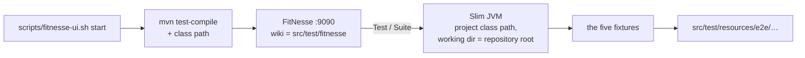

`CompareSuite`, all 20 pages green (121 assertions):

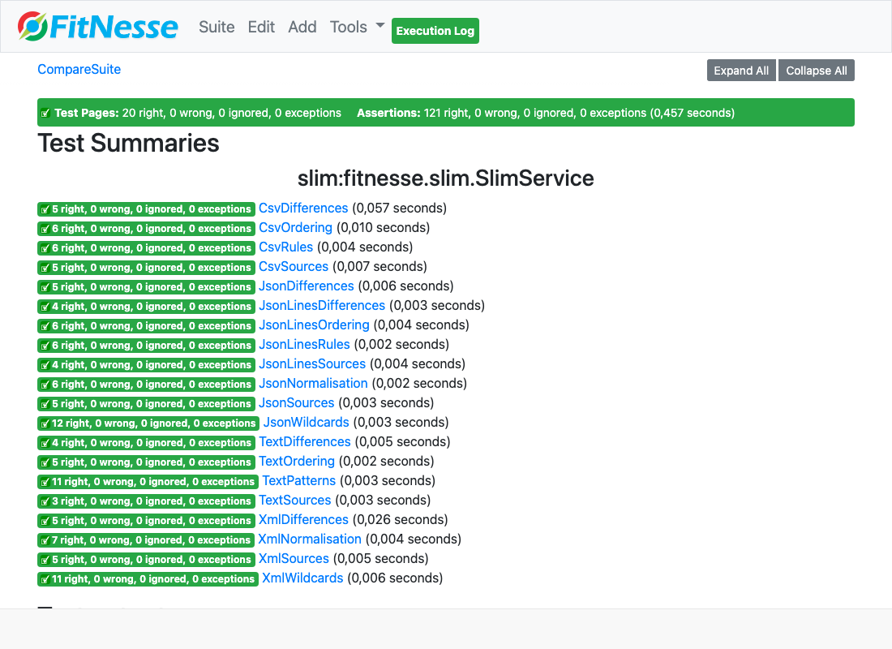

A page of `CompareSuite`: each mismatch is asserted against the exact HTML, so the differences are rendered:

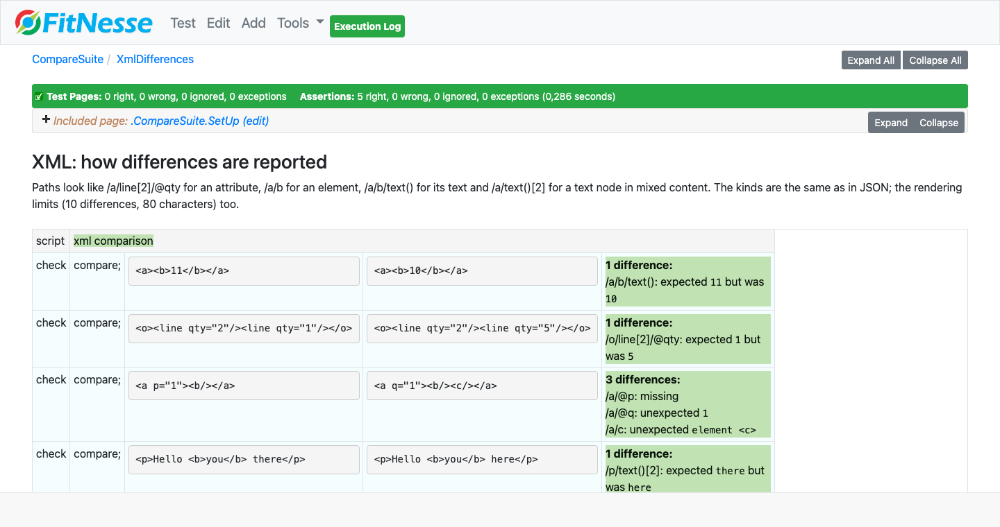

The same for CSV: cell paths, a header mismatch, a missing and an unexpected row:

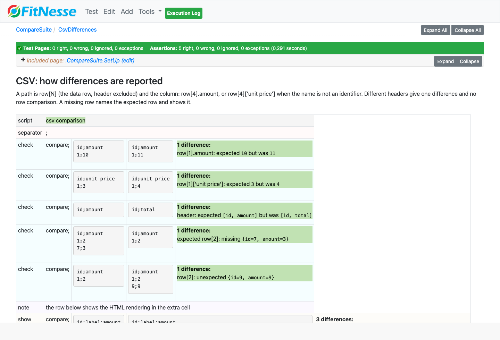

Setting rows hold until the end of the table: the same rows fail in order, pass with `unordered` or `key`:

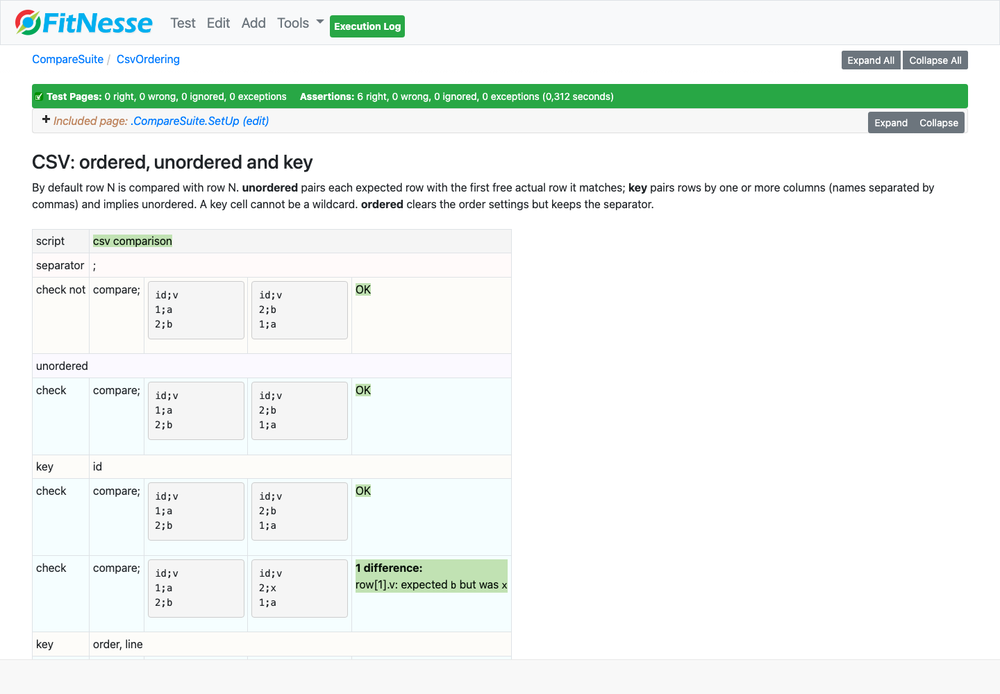

`CompareErrorSuite`: every row raises, with the message in the yellow cell:

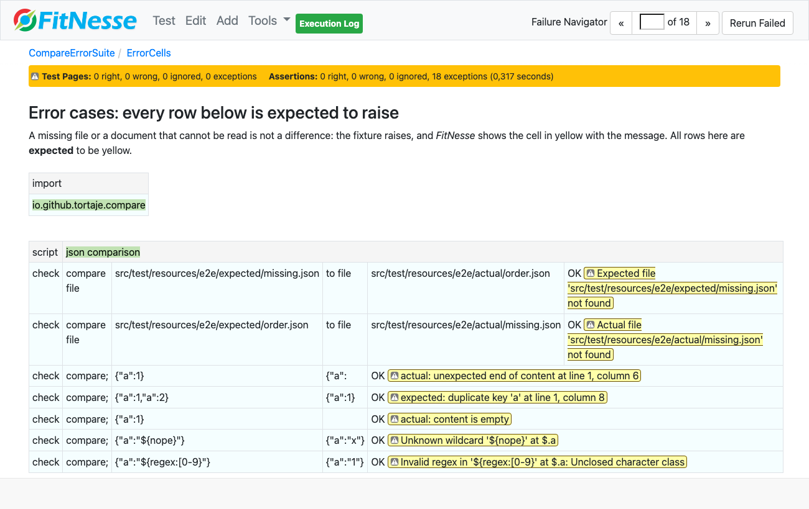

## License

[Apache License 2.0](LICENSE)
